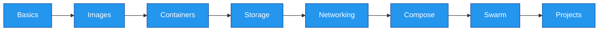

<div align="center">

**Containers, images, volumes, networking, Compose, Swarm, and real projects. Learn it by running it.**

<br>


<br>

[Learning Path](#learning-path) &nbsp;|&nbsp; [Quick Start](#quick-start) &nbsp;|&nbsp; [Commands](#command-reference) &nbsp;|&nbsp; [Troubleshooting](#troubleshooting) &nbsp;|&nbsp; [Roadmap](#roadmap)

<br>


</div>

<br>

## What You Will Learn

| Build | Run | Orchestrate |
|---|---|---|
| Dockerfiles and images | Containers and lifecycle | Docker Compose |
| Optimized builds | Volumes and bind mounts | Swarm: scale, self-heal, rollback |
| Docker Hub workflow | Container networking | Real-world projects |

<br>

## Learning Path



| | Module | Focus |
|:---:|---|---|
| **01** | [Basics](./01-Basics) | Docker, containers, architecture, Docker vs VMs |
| **02** | [Images and Dockerfile](./02-Images-and-Dockerfile) | Build, tag, and manage images |
| **03** | [Container Management](./03-Container-Management) | Run, stop, inspect, clean up |
| **04** | [Storage](./04-Storage) | Volumes, bind mounts, persistent data |
| **05** | [Networking](./05-Networking) | Bridge, host, custom networks |
| **06** | [Compose](./06-Compose) | Multi-container apps with YAML |
| **07** | [Reference](./07-Reference) | Quick-lookup Docker commands |
| **08** | [Projects & Sample Templates](./08-docker-projects%20%26%20Sample%20Templates) | Real projects and reusable templates |
| **+** | [Docker Swarm](./Docker-Swarm) | Init, services, scaling, rolling updates, rollback |

<div align="center">

[](./Docker.pdf)
[](./docker-cheatsheet.pdf)

</div>

<br>

## Quick Start

```bash
# verify Docker
docker --version && docker compose version && docker run hello-world

# clone and begin
git clone https://github.com/Shubhamx18/docker-workbench.git
cd docker-workbench/01-Basics
```

**Requirements:** Git, Docker (Engine or Desktop), Docker Compose v2, basic Linux commands.

<br>

## Command Reference

<details>
<summary><b>Images</b></summary>

```bash
docker build -t myapp:1.0 .            # build an image
docker images                          # list images
docker tag myapp:1.0 <user>/myapp:1.0  # tag for Docker Hub
docker push <user>/myapp:1.0           # push to Docker Hub
docker rmi myapp:1.0                   # remove an image
```
</details>

<details>
<summary><b>Containers</b></summary>

```bash
docker run -d --name web -p 8080:80 nginx   # run in background, map a port
docker ps -a                                # list all containers
docker logs -f web                          # follow logs
docker exec -it web sh                      # shell inside the container
docker stop web && docker rm web            # stop and remove
```
</details>

<details>
<summary><b>Volumes and Networks</b></summary>

```bash
docker volume create mydata
docker run -d -v mydata:/data myapp
docker network create mynet
docker run -d --network mynet --name api myapp
```
</details>

<details>
<summary><b>Compose</b></summary>

```bash
docker compose up -d        # start all services
docker compose ps           # service status
docker compose logs -f      # follow logs
docker compose down -v      # stop and remove services and volumes
```
</details>

<details>
<summary><b>Swarm</b></summary>

```bash
docker swarm init --advertise-addr <your-ip>     # initialize
docker node ls                                   # list nodes

docker service create --name web --replicas 3 -p 8080:80 nginx
docker service ls
docker service ps web

docker service scale web=5                       # scale
docker service update --image nginx:1.27 \
  --update-parallelism 1 --update-delay 10s web  # rolling update
docker service rollback web                      # rollback
docker service rm web                            # remove
```
</details>

<details>
<summary><b>Cleanup</b></summary>

```bash
docker system df       # disk usage
docker system prune    # remove unused containers, networks, dangling images
```
</details>

<br>

## Troubleshooting

<details>
<summary><b>Common errors and fixes</b></summary>

<br>

| Problem | Fix |
|---|---|
| `permission denied` on `docker.sock` | `sudo usermod -aG docker $USER`, then log out and in |
| `port is already allocated` | Use another host port, e.g. `-p 8081:80` |
| Container exits immediately | Check `docker logs <container>` |
| Code changes not reflected | `docker compose up -d --build` |
| Containers cannot reach each other | Same user-defined network, use container name as host |
| `could not choose an IP address to advertise` | `docker swarm init --advertise-addr <your-ip>` |
| Swarm service stuck at `0/3` | `docker service ps <service> --no-trunc` |

</details>

<br>

## Roadmap

- [x] Docker fundamentals, images, containers, storage, networking
- [x] Docker Compose
- [x] Docker Swarm
- [ ] Kubernetes
- [ ] CI/CD with Jenkins or GitHub Actions
- [ ] Infrastructure as Code with Terraform
- [ ] Container security scanning

<br>

<div align="center">

**Built by [Shubham](https://github.com/Shubhamx18)**

</div>


